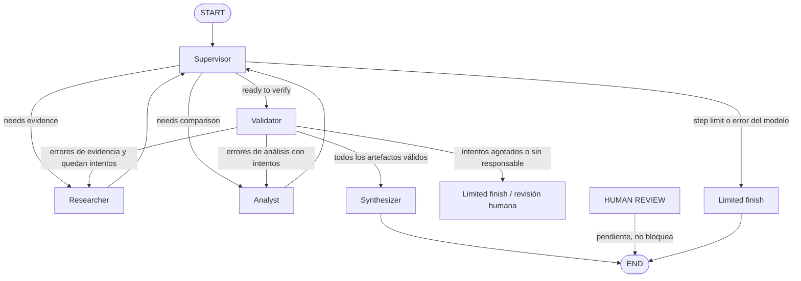
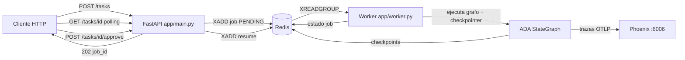

# Architecture Decision Assistant (ADA)

Asistente multiagente para decisiones de arquitectura de software basadas en evidencia, construido con Python, LangGraph, Pydantic y Groq.

## Problema que resuelve

ADA recibe un escenario técnico (por ejemplo, decidir si una API .NET debe ser monolito, monolito modular o microservicios), recupera evidencia de un corpus técnico local, compara alternativas con criterios ponderados y genera una recomendación final trazable. Las afirmaciones basadas en el corpus citan sus fuentes; el análisis numérico se calcula con Python determinístico, no con el LLM.

## Topología jerárquica y responsabilidad de cada nodo



### Por qué esta topología

Se eligió un **supervisor centralizado** frente a alternativas como la colaboración entre pares o el enrutamiento por cadena fija, porque el flujo de decisión tiene una secuencia natural (evidencia → análisis → validación → informe) que conviene dirigir desde un único punto con salida estructurada. Esto permite: (1) imponer los límites globales (pasos y reintentos) en Python, no por decisión del LLM; (2) verificar de forma determinística las reglas críticas (el Synthesizer solo corre con validación vigente aprobada, y `END` solo declara éxito con informe completo vigente); y (3) mantener a cada especialista dueño de sus propios campos, sin contaminación de contexto. Los conflictos entre agentes no se negocian entre pares: los arbitra el Validator, que clasifica cada error por el especialista responsable y acota las rondas de reparación.

### Responsabilidad de cada nodo

- **Supervisor**: coordina y enruta dinámicamente entre especialistas con salida estructurada (`RoutingDecision`) validada con Pydantic. No investiga ni calcula puntajes. Impone límites globales de pasos (8). Ante fallo del modelo, enruta a `limited_finish` de forma segura.
- **Researcher**: recupera evidencia del corpus con `HybridRetriever` (BM25 + embeddings + RRF) y devuelve un `ResearchArtifact` con fuentes. Si hay errores de validación pendientes, regenera su propio artefacto (reemplazando la versión inválida) y limpia los errores del estado.
- **Analyst**: construye el análisis desde la solicitud del usuario, el perfil del sistema, los criterios y la evidencia recuperada (`derive_scores_from_evidence`). Los totales los calcula Python (`calculate_weighted_score`, `rank_alternatives`), nunca el LLM. Si hay errores de análisis, reintenta con los errores específicos en el estado.
- **Validator**: nodo determinístico (no LLM). Valida contratos Pydantic, pesos, rangos de puntajes, referencias a evidencias y coherencia con el scoring calculado. Clasifica cada error por el especialista responsable (`research_errors` / `analysis_errors`) y entrega los errores específicos en el estado (`validation_errors`).
- **Synthesizer**: genera el informe final solo si el validador aprobó. Si la validación falló, el informe queda como `needs_human_review`, nunca como recomendación definitiva.

## Ciclo de validación y reparación

1. El Supervisor delega en Researcher y Analyst según el estado.
2. El Validator ejecuta validaciones determinísticas (contratos Pydantic, pesos, rangos, referencias, coherencia con scoring) y clasifica cada error por el especialista responsable.
3. Si hay errores corregibles y quedan intentos (`retries < ADA_MAX_RETRIES`), el grafo enruta al especialista responsable con los errores específicos en `validation_errors`; el contador de reintentos se incrementa en Python, nunca por decisión del LLM.
4. El especialista regenera su propio artefacto (reemplazando la versión inválida) y limpia los errores pendientes.
5. Si todos los artefactos son válidos, el Synthesizer produce el informe final.
6. Si se agotan los intentos, el flujo termina con `limited_finish` (resultado seguro, revisión humana pendiente). Nunca sintetiza un informe exitoso con artefactos inválidos.

## Invalidación de validaciones e informes obsoletos

Los resultados previos caducan cuando cambia la evidencia en la que se basan:

- Cada vez que Researcher o Analyst actualiza su artefacto (flujo normal o ronda de reparación), invalida explícitamente la validación previa **y** el informe final previo (`validation_result = None`, `final_report = None`).
- El Synthesizer solo se ejecuta con una validación vigente aprobada; el enrutamiento post-Supervisor lo verifica de forma determinística: si el Supervisor propone `synthesizer` sin validación vigente aprobada, el grafo enruta al Validator.
- `END` solo declara éxito con informe completo **y** validación vigente aprobada. Un `END` sin informe exitoso vigente no se presenta como éxito: completa la validación o termina de forma segura.
- Al agotarse los reintentos, el flujo termina de manera segura (`limited_finish`) con revisión humana pendiente, sin declarar éxito.
- Los límites existentes se preservan: `ADA_MAX_RETRIES` rondas de reparación y `ADA_MAX_STEPS` pasos globales, impuestos en Python.

## AgentState y aislamiento de escritura

`AgentState` (en `src/ada/state.py`) es el estado compartido de LangGraph. Cada nodo es dueño solo de sus campos y devuelve actualizaciones parciales:

- **Supervisor**: `next_agent`, `routing_reason`, `steps`, `task_completed`.
- **Researcher**: `research_artifact`.
- **Analyst**: `analysis_artifact`.
- **Validator**: `validation_result`, `retries`, `validation_errors`.
- **Synthesizer**: `final_report`.

La traza auditable (`contributions`) registra por cada paso: agente, tipo de artefacto, resumen, paso, decisión, motivo, intento y errores relevantes. No guarda secretos ni historiales enormes.

## Recuperación híbrida y trazabilidad

- **BM25** (léxico) + **embeddings** (`all-MiniLM-L6-v2` local) + **RRF (Reciprocal Rank Fusion)** con `1/(k + rank)`.
- Cada evidencia conserva `document_id`, `source_uri`, `excerpt`, `retrieval_method` y `content_hash`.
- Si no hay evidencia, el `ResearchArtifact` lo declara en `evidence_gaps`; no se fabrican fuentes.

## Scoring determinístico y límites del análisis asistido por LLM

- **Scoring**: cada alternativa se puntúa de 1 a 5 por criterio. Python calcula `suma(peso × score/5)` con `calculate_weighted_score` y ordena con `rank_alternatives`. Los pesos suman 1 con tolerancia pequeña y Python valida la coherencia.
- **Derivación de puntajes**: `derive_scores_from_evidence` puntúa por señales del caso de uso (solicitud del usuario + perfil del sistema) contra la evidencia recuperada. Los criterios sin respaldo de evidencia se marcan `is_assumption=True`.
- **Límite del LLM**: el LLM solo coordina el enrutamiento y puede proponer puntajes como propuestas sujetas a validación; nunca calcula totales ni decide la reparación.

## Instalación y configuración

```bash
uv sync --extra dev --extra retrieval
cp .env.example .env
```

Añade tu `GROQ_API_KEY` a `.env`. Nunca hagas commit de `.env`.

Variables de entorno (ver `.env.example`):

- `GROQ_API_KEY`: clave de Groq (requerida solo para la demo LLM en vivo).
- `ADA_LLM_PROVIDER`, `ADA_LLM_MODEL`, `ADA_TEMPERATURE`: proveedor y modelo (default `openai/gpt-oss-20b`; los modelos `llama-3.3-*` ya no están disponibles en Groq).
- `ADA_MAX_STEPS`: límite global de pasos (default 8).
- `ADA_MAX_RETRIES`: máximo de rondas de reparación tras el primer intento (default 2). Con `2`, una decisión puede repararse hasta dos veces antes de terminar de forma segura.
- `ADA_TOP_K`: evidencias a recuperar (default 5).
- `ADA_EMBEDDING_MODEL`: modelo de embeddings local.

## Ejecución

```bash
# Tests (sin red, sin claves)
uv run pytest

# Lint
uv run ruff check .

# Consola interactiva (requiere GROQ_API_KEY)
uv run python -m ada

# Modo one-shot: una consulta y sale (útil para scripts y demos grabadas)
uv run python -m ada "Decidir si una API .NET debe ser monolito modular o microservicios"
uv run python -m ada --request "..." --verbose
```

### Consola interactiva y eventos en vivo

Al ejecutar `uv run python -m ada` se abre una sesión interactiva:

- Escribe una consulta de decisión de arquitectura y presiona Enter.
- El grafo se ejecuta en vivo: cada nodo (Supervisor, Researcher, Analyst, Validator, Synthesizer) imprime una línea conforme se ejecuta, usando el streaming real de LangGraph (`astream(..., stream_mode="updates")`). No hay pasos simulados.
- Salir con `quit`, `exit` o EOF (Ctrl+D / Ctrl+Z). `help` muestra la ayuda. Las entradas vacías se vuelven a pedir sin ejecutar el grafo.
- `--verbose` muestra detalles adicionales por nodo (filtra claves, tokens e historial de mensajes; nunca vuelca el estado completo). Se aplica a cada consulta, tanto en modo one-shot como en la sesión interactiva.

Eventos que aparecen en vivo (solo si el nodo los emite):

- **Supervisor**: el agente elegido y el motivo (`Enruta a: Researcher — <motivo>`).
- **Researcher**: cantidad de evidencias recuperadas.
- **Analyst**: ranking parcial de alternativas.
- **Validator**: resultado de validación, errores bloqueantes, avisos, número de intento y revisión humana pendiente.
- **Synthesizer**: estado del informe generado.
- **Finalización segura**: el flujo terminó sin recomendación definitiva.

Al terminar, un `RESUMEN FINAL` separado muestra el estado real (completado / requiere revisión humana / finalización segura), la recomendación, alternativas comparadas, puntajes, fuentes trazables y errores pendientes. Un informe inválido nunca se presenta como exitoso.

## Ejemplo de ejecución e interpretación de la traza

```
--- Ejecutando el grafo (eventos en vivo) ---
[Supervisor]
  Enruta a: Researcher — No research artifact exists; need evidence...
[Researcher]
  Evidencias recuperadas: 5
[Supervisor]
  Enruta a: Analyst — Research evidence is available...
[Analyst]
  Ranking: microservices > modular-monolith > monolith
[Supervisor]
  Enruta a: Validator — Research and analysis artifacts are ready...
[Validator]
  Validación: aprobada
[Synthesizer]
  Informe generado (estado: complete)

============================================================
RESUMEN FINAL
============================================================
Resultado: decisión completada.
Estado del informe: complete
Recomendación: Recomendación: 'Microservicios' (puntaje ponderado 0.940).
Alternativas comparadas: Monolito, Monolito modular, Microservicios

Puntuaciones ponderadas:
  - Monolito: 0.940
  - Monolito modular: 0.940
  - Microservicios: 0.940
  Ranking: microservices > modular-monolith > monolith

Fuentes (5):
  - [doc-microservices-tradeoffs] Monolith first
    Origen: https://martinfowler.com/bliki/MonolithFirst.html
  ...
```

Interpretación de la traza (`contributions`): cada registro incluye `agent`, `artifact_type`, `summary`, `step`, `decision`, `reason`, `attempt` y `errors`. Un `attempt > 0` indica una ronda de reparación tras validación; los `errors` listados son los errores concretos que el especialista corrigió.

## Gestión de errores y revisión humana

- Sin evidencia suficiente: el `ResearchArtifact` lo declara en `evidence_gaps`; no se fabrican fuentes.
- Validación con errores: el grafo enruta al especialista responsable (máximo `ADA_MAX_RETRIES` reparaciones); al agotarse, el informe queda `limited` o `needs_human_review`, con los errores visibles.
- Fallo del LLM o salida inválida: el supervisor usa una ruta segura (`limited_finish`) y el flujo termina controlado, sin bucles.

**Qué significa "requiere revisión humana"**: el sistema no pudo completar una decisión validada y no emite recomendación definitiva. No bloquea el programa ni finge una revisión real: deja el resultado marcado (`needs_human_review` o `limited`) con los errores visibles para que una persona los revise manualmente.

## Limitaciones

- La evidencia disponible está definida por el corpus local versionado en `data/corpus/`.
- El scoring por defecto es una línea base determinística basada en señales de palabras clave; no reemplaza el juicio experto.
- No hay interfaz web, base de datos externa ni infraestructura cloud: solo Groq para las llamadas LLM de la demo.
- El streaming muestra los campos útiles descritos arriba; los eventos dependen de lo que cada nodo emita en su actualización. No se muestran datos que no estén disponibles realmente.
- La integración real con el proveedor (Groq) se probó manualmente con una clave configurada; la suite automatizada funciona con fakes/mocks y no requiere clave.

## Principios de diseño

- La evidencia conserva identificadores de fuente y procedencia.
- El scoring numérico lo calcula Python, no el LLM.
- Cada nodo del grafo es dueño solo de sus campos de salida en el estado compartido.
- El supervisor tiene routing explícito y límites de terminación.
- La decisión post-validación es determinística, no depende del modelo.
- La evidencia faltante se reporta, no se fabrica.

---

# Pre-entrega 7: API de producción y monitoreo activo

Esta versión evoluciona el asistente multiagente de la Pre-entrega 6 hacia
producción: API REST asíncrona (FastAPI), persistencia del estado y de los
checkpoints en Redis, Human-in-the-loop real con `interrupt()` de LangGraph,
observabilidad con Arize Phoenix y prueba de carga con 5 peticiones
concurrentes. El grafo, los agentes y las reglas de validación de la entrega
anterior se reutilizan sin cambios funcionales.

## Arquitectura de la API



- **API (`app/main.py`)**: recibe la tarea, la persiste en Redis (`PENDING`),
  la encola en un Redis Stream y responde `202 Accepted` con el `job_id`.
  Nunca ejecuta el grafo dentro de la petición HTTP.
- **Worker (`app/worker.py`)**: proceso independiente (`python -m app.worker`)
  que consume los streams de Redis, ejecuta el grafo en un thread pool
  (`asyncio.to_thread`) y actualiza el estado del job. Confirma cada mensaje
  con `XACK` después de procesarlo (el job quedó en un estado controlado);
  si el worker muere antes de confirmar, el mensaje queda pendiente y se
  recupera con `XAUTOCLAIM` — ningún trabajo se pierde ni se ejecuta dos
  veces sin control.
- **JobStore (`app/worker.py`)**: estado operacional del job en Redis
  (`PENDING → RUNNING → WAITING_APPROVAL → DONE | FAILED`).
- **Checkpointer (`app/graph.py`)**: `RedisSaver` de
  `langgraph-checkpoint-redis`, con `thread_id = job_id` estable por trabajo.
  Sin `REDIS_URL` configurada, cae a `MemorySaver` (tests y CLI sin Docker).
- **HITL (`app/hitl.py`)**: nodo `hitl_approval` entre START y el Supervisor.
  Las tareas críticas se pausan con `interrupt()` real (checkpoint en Redis)
  y se reanudan con `Command(resume=...)` desde el mismo `thread_id`.

### Estados de un job

`PENDING → RUNNING → (WAITING_APPROVAL → RESUME_QUEUED → RUNNING) → DONE | FAILED`

- `WAITING_APPROVAL`: el grafo está pausado en el interrupt HITL.
- `RESUME_QUEUED`: transición atómica (`HSETNX`) que garantiza que una
  segunda aprobación reciba `409` y el grafo no se reanude dos veces.

## Endpoints

| Método | Ruta | Descripción |
|--------|------|-------------|
| `GET` | `/health` | Liveness + conectividad Redis |
| `POST` | `/tasks` | Crea el job (202). Body: `{"user_request": "...", "critical": false}` |
| `GET` | `/tasks/{job_id}` | Estado, timestamps, resultado o error (404 si no existe) |
| `POST` | `/tasks/{job_id}/approve` | Aprobación/rechazo humano (409 si no está en `WAITING_APPROVAL`) |

Errores: `404` job inexistente, `409` aprobación fuera de `WAITING_APPROVAL`
(cubre la doble aprobación), `422` payload inválido (Pydantic), `500` con
mensaje genérico (el stack trace queda solo en el log del servidor).

## Human-in-the-loop (HITL)

Política determinística (`app/hitl.py`, no depende del LLM). Una tarea es
crítica cuando:

1. El cliente la marca con `critical=true` en `POST /tasks` (flag
   `hitl_required` en el estado).
2. Su costo estimado supera `ADA_HITL_COST_THRESHOLD` (default 0.50 USD).
3. Invoca herramientas con efectos secundarios declarados (`pending_tools`).

Flujo de una tarea crítica:

1. `POST /tasks` con `critical: true` → job `PENDING`.
2. El worker ejecuta el grafo; el nodo `hitl_approval` llama `interrupt()`
   y el checkpoint se guarda en Redis → job `WAITING_APPROVAL`.
3. El cliente consulta `GET /tasks/{id}` y recibe `WAITING_APPROVAL` + `hitl_reason`.
4. Un humano envía `POST /tasks/{id}/approve` con `{"approved": true|false}`.
5. La API marca `RESUME_QUEUED` (atómico) y encola la reanudación.
6. El worker reanuda con `Command(resume={"approved": ...})` sobre el mismo
   `thread_id`: los agentes ya ejecutados no se repiten.
7. Resultado final `DONE` (informe completo) o `FAILED`.

Si se rechaza (`approved: false`), el grafo termina en `limited_finish`:
parada segura sin ejecutar la acción protegida, con el rechazo registrado
en la traza (`contributions`).

## Observabilidad con Arize Phoenix

- Instrumentación automática de LangChain/LangGraph con
  `openinference-instrumentation-langchain` + OpenTelemetry (OTLP HTTP).
- Configuración por variables: `PHOENIX_COLLECTOR_ENDPOINT` y
  `PHOENIX_PROJECT_NAME` (ver `.env.example`).
- Cada job asocia sus trazas a una sesión (`openinference.session.id` =
  `job_id`), visible en el dashboard de Phoenix.
- Los spans de LLM incluyen modelo, tokens de entrada/salida y duración
  cuando el proveedor los reporta. **Limitación conocida**: Phoenix no
  calcula automáticamente el costo para todos los modelos de Groq; si el
  modelo elegido no está soportado, el dashboard muestra los tokens pero no
  el costo. Verificar en el dashboard antes de la prueba definitiva y
  documentar el resultado (no se inventan valores).
- Una falla de telemetría nunca rompe un trabajo: la inicialización y el
  contexto de trazas están protegidos y degradan a "sin trazas".

### Costo por ejecución (tokens + tarifas configurables)

El worker registra el uso de tokens que el proveedor reporta en cada
respuesta del LLM (`usage_metadata` de langchain-core) y lo persiste en el
hash del job en Redis. `GET /tasks/{id}` lo expone en el campo `usage`:

```json
{
  "usage": {
    "tokens_available": true,
    "input_tokens": 1234,
    "output_tokens": 567,
    "total_tokens": 1801,
    "llm_calls": 4,
    "model": "openai/gpt-oss-20b",
    "estimated_cost_usd": 0.000468,
    "cost_note": "Costo estimado con tarifas configurables (ADA_MODEL_RATES)..."
  }
}
```

- Tarifas por modelo en USD por millón de tokens, configurables con
  `ADA_MODEL_RATES` (JSON; ver `.env.example`). Hay valores por defecto
  para los modelos de Groq más comunes.
- Si el proveedor no informa tokens, o el modelo no tiene tarifa
  configurada, el campo se registra como **no disponible** con una nota
  explicativa: nunca se inventan valores.
- `scripts/load_test.py` muestra el costo por ejecución y el total de la
  corrida cuando hay datos de tokens.
- Phoenix calcula el costo automáticamente solo para modelos soportados;
  verificar en el dashboard y usar las capturas de `screenshots/` como
  evidencia complementaria.

## Prueba de carga (5 peticiones concurrentes)

```bash
# Con la API y el worker corriendo (local o docker compose):
uv run python scripts/load_test.py --url http://localhost:8000 --timeout 300
```

- Envía 5 `POST /tasks` simultáneos con un escenario **no crítico** (sin HITL).
- Hace polling de cada job hasta `DONE`/`FAILED` con timeout configurable
  (`--timeout`, default 300 s).
- Reporta latencia por job, media, máxima, global y **p95**.
- Método del p95: `statistics.quantiles(data, n=20, method="inclusive")`,
  interpolación lineal equivalente a `numpy.percentile(..., method="linear")`.
  Para n=5: `p95 = x[4] + 0.95 × (x[5] − x[4])` sobre los datos ordenados.
- Las 5 ejecuciones deben aparecer en Phoenix como sesiones separadas
  (filtro por `openinference.session.id`).

## Docker Compose

```bash
cp .env.example .env   # completar GROQ_API_KEY
docker compose up --build -d
curl http://localhost:8000/health   # {"status":"ok","redis":true}
```

Servicios: `redis` (healthcheck + volumen persistente), `phoenix`
(UI en http://localhost:6006, volumen persistente), `app` (API, puerto
8000) y `worker` (`python -m app.worker`). La API y el worker comparten
Redis para la cola (streams `ada:jobs` y `ada:jobs:resume`) y el estado de
jobs; el checkpointer de LangGraph (`RedisSaver`) usa la misma instancia de
Redis y se inicializa una vez por proceso (`get_checkpointer()`).

## Ejemplos de uso

```bash
# Crear una tarea (202 + job_id)
curl -X POST http://localhost:8000/tasks \
  -H "Content-Type: application/json" \
  -d '{"user_request": "Decidir si una API .NET debe ser monolito modular o microservicios", "critical": false}'

# Consultar estado (polling)
curl http://localhost:8000/tasks/{job_id}

# Tarea crítica: se pausa en WAITING_APPROVAL
curl -X POST http://localhost:8000/tasks \
  -H "Content-Type: application/json" \
  -d '{"user_request": "Migrar la base de datos de producción a otro proveedor", "critical": true}'

# Aprobar (reanuda el grafo desde el checkpoint)
curl -X POST http://localhost:8000/tasks/{job_id}/approve \
  -H "Content-Type: application/json" \
  -d '{"approved": true, "comment": "Aprobado por el arquitecto"}'

# Rechazar: el grafo termina de forma segura (limited_finish)
curl -X POST http://localhost:8000/tasks/{job_id}/approve \
  -H "Content-Type: application/json" \
  -d '{"approved": false}'
```

## Evidencias en `screenshots/`

Ver `screenshots/README.md`: capturas requeridas (traza completa, 5
ejecuciones concurrentes, latencia p95, costo/tokens), procedimiento para
tomarlas y estado actual. No se incluyen capturas simuladas.

## Tests

```bash
uv run pytest                 # 161 tests: 137 unitarios + 24 de integración
uv run pytest tests/integration -q   # solo los nuevos (API, worker, HITL)
```

Los tests de integración usan `fakeredis` y fake chat models: no requieren
Docker, Redis real ni clave de Groq. Cubren: validación de payloads,
transiciones de estado, `FAILED` ante fallos del worker, política de
criticidad HITL, aprobación/rechazo/doble aprobación vía endpoint
(transición atómica), checkpointer que falla explícitamente si Redis está
configurado pero inalcanzable, confirmación de mensajes con `XACK`,
registro de tokens/costo (`app/cost.py`) y 5 jobs concurrentes.

## Limitaciones conocidas (Pre-entrega 7)

- El cálculo de costo por ejecución en Phoenix depende del soporte del
  modelo de Groq elegido; si no está soportado, el dashboard muestra tokens
  y duración pero no costo. No se fabrican valores.
- Las capturas de `screenshots/` requieren ejecutar el entorno real
  (Docker + GROQ_API_KEY); están marcadas como pendientes en su README.
- `ADA_USE_FAKEREDIS=1` permite correr la API sin Docker para desarrollo,
  pero no persiste datos entre reinicios del proceso.
- El worker procesa los mensajes de forma secuencial por consumidor; para
  escalar horizontalmente, levantar más réplicas del servicio `worker`
  (el consumer group de Redis Streams distribuye los mensajes).
